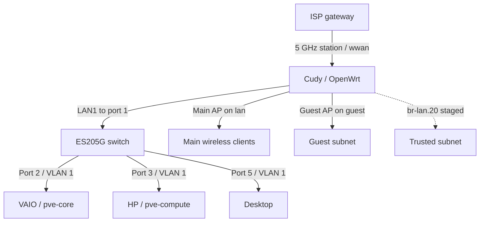
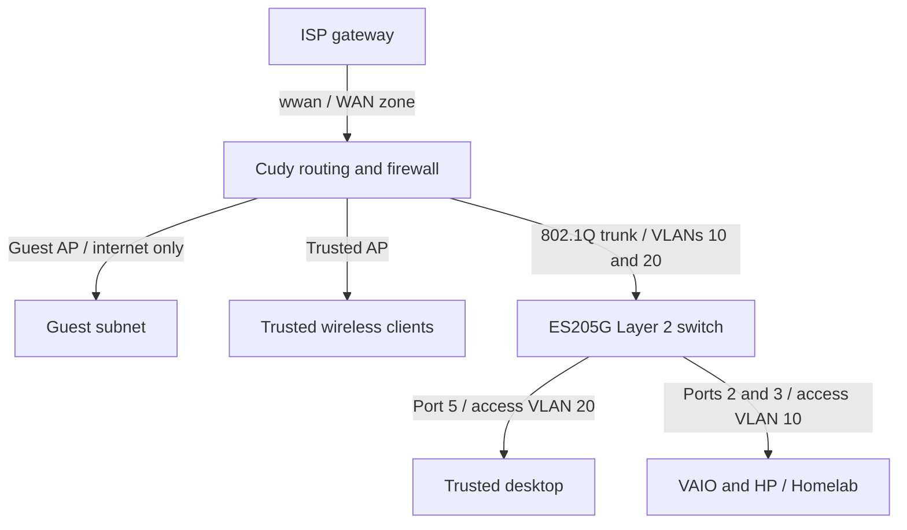
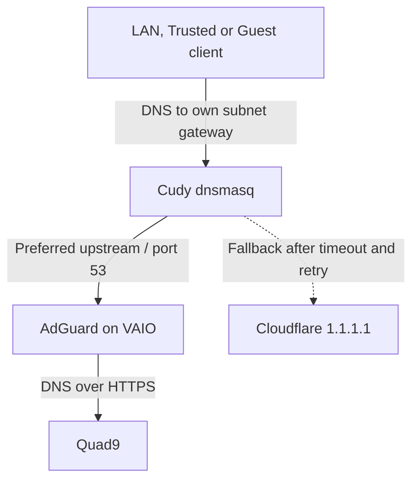

# Architecture and Availability

Recorded through **11 October 2026**. Addresses and identifiers are fictional substitutes. Diagrams are sanitized reconstructions; current state and target are separate.

## Current physical and logical state

Cudy routes between upstream and internal subnets. The WISP link is not a transparent Layer 2 bridge. The ordinary IPv4 arrangement has NAT at the ISP router and Cudy. Public exposure and IPv6 have not been fully audited.

The switch has VLANs 10 and 20 tagged on its uplink, but endpoint ports remain untagged VLAN 1. Cudy shows `lan` on `br-lan.1` and `trusted` on `br-lan.20`. This stages the new path without yet placing endpoints into their target VLANs.

Guest Wi-Fi uses `br-guest` and its own subnet. No switch Guest VLAN is needed for this Wi-Fi-only design. Guest internet and isolation were confirmed by the user; a two-client isolation test and full IPv6 validation were not supplied.

## Target design — not fully deployed

| Segment | Switch VLAN | Router interface / target device | Intent |
|---|---|---|---|
| Homelab | **10** | Keep `lan`, change to `br-lan.10` | Servers and hosted services |
| Trusted | **20** | `trusted` / `br-lan.20` | Personal clients and selected administration |
| Guest | Not carried on switch | `guest` / `br-guest` | Internet and router DNS/DHCP only |

These IDs supersede the early drawing with Guest VLAN 10 and Homelab VLAN 30. VLAN identifiers do not dictate IP subnet numbers.

The switch separates Ethernet broadcast domains. Cudy provides inter-subnet routing and routed firewall policy. This is a compact router-plus-managed-switch design; the ES205G is not a Layer 3 routing core.

## Intended traffic policy

| Initiator | Destination | Purpose | Target policy |
|---|---|---|---|
| Guest | Own Cudy gateway | DNS TCP/UDP 53; DHCP UDP 67 | Specific INPUT exceptions |
| Guest | Internet | Normal client traffic | Allow via WAN |
| Guest | ISP subnet / other internal networks | Private device or management access | Reject |
| Trusted | Cudy | DNS, DHCP and selected administration | Specific INPUT exceptions |
| Trusted | Homelab | Selected PVE, PDM and AdGuard administration | Specific IP/port FORWARD exceptions |
| Trusted | Switch | Management | Allow after management placement is decided |
| Trusted | Internet | Normal client traffic | Allow via WAN |
| Cudy itself | AdGuard | Upstream DNS forwarding | OUTPUT, TCP/UDP 53 |
| Homelab | Internet | Updates and service dependencies | Allow via WAN |
| Homelab | Trusted / Guest | New unsolicited sessions | Reject by default |
| Permitted session | Original requester | Replies | Stateful established/related handling |

This is intent, not proof of a completed ruleset. See the [rule ledger](vlan-migration.md). DNS replies are return traffic; they do not require a separate broad server-to-client permission.

Initial administration permissions apply to the Trusted zone. Device-specific restrictions would require an additional addressing/access-control decision. A hidden SSID does not establish trust.

## DNS path

Each subnet advertises its own Cudy gateway as client DNS. DHCP option **6** advertises a DNS-server IP; it is not a port number or firewall permission.

`/etc/homelab-dns-upstreams.conf` orders AdGuard first and `1.1.1.1` second. The recorded design uses `strictorder=1`, `allservers=0` and resolver-file reading. AdGuard's displayed public upstream is `https://dns10.quad9.net/dns-query`.

The 6 October stopped-container test needed a client retry after roughly three seconds. This is not instantaneous health-monitor failover. Tests cleared router caches; cached public answers may remain after AdGuard returns until TTL expiry. Filtering is unavailable on fallback. Manual DNS, browser/private DNS and VPN DNS may bypass this path; enforcement is not deployed.

AdGuard normally sees Cudy as the querying client. Keeping the Homelab subnet and service IPs during VLAN migration preserves the upstream address. Clients do not need direct AdGuard DNS access in this chosen design.

## Services and management

| Location | Running component | Role |
|---|---|---|
| Cudy | OpenWrt, DHCP and dnsmasq | Gateway, firewall and client DNS |
| VAIO | CT 100: AdGuard | Filtering resolver |
| VAIO | CT 102: Tailscale | Remote lab subnet access |
| VAIO | CT 200: PDM | Combined management of independent PVE hosts |
| HP | Proxmox VE | Capacity for future compute guests |

PDM does not create a PVE cluster, pool resources, replicate guests or provide HA. Hosts operate independently of its dashboard. An additional stopped container appeared earlier; its purpose is unrecorded.

Tailscale is a native service in its own LXC, not on Cudy. Authentication/route approval were discussed and connection reported successful. Remote/mobile-data and restart tests remain unrecorded. Retaining the real Homelab subnet preserves the advertised route definition. Remote access to Trusted would be a separate route, grant and firewall decision.

Hosts and current guests can remain untagged on switch access VLAN 10. Per-guest VLAN tags or a Proxmox trunk are unnecessary for this single-VLAN host design; putting guests in different VLANs would be a separate change.

## Switch management decision

Management is currently **VLAN 1** with the selected static address. Two choices remain open:

| Choice | Benefit | Consequence |
|---|---|---|
| Move management to Homelab VLAN 10, retain IP | Preserves the address plan | Homelab peers can reach switch management without passing Cudy |
| Move management to Trusted VLAN 20, use Trusted IP | Places management with administrators | Requires a new IP/gateway and updated destination-specific rule |

Routed management needs a correct switch return gateway. That gateway and saved-config persistence after a power cycle are not independently verified. Do not silently choose the management placement during migration.

Same-VLAN traffic bypasses Cudy's routed firewall. Restricting peer access inside Homelab needs host/service firewalls or further segmentation.

## When the VAIO is off

| Function | Expected behavior | Evidence limit |
|---|---|---|
| Cudy routing, DHCP and Wi-Fi | Continues while router/upstream stay powered | Independent of VAIO |
| External DNS | Public fallback with possible retry delay | Container shutdown tested; whole VAIO shutdown untested |
| AdGuard filtering | Unavailable | Runs on VAIO |
| Tailscale through this guest | Unavailable | Runs on VAIO |
| PDM dashboard | Unavailable | Runs on VAIO |
| HP and future guests | Continue independently | No PVE cluster dependency |
| Future NPM service URLs | Depend on VAIO if hosted there | NPM not deployed |

The laptop battery backs only the laptop.

## Future services

Nginx Proxy Manager remains planned for the VAIO after segmentation and backups. Tentative sizing was one core, 768 MiB RAM, 256 MiB swap and 8 GiB disk with SQLite; no deployment/load test exists. Limited router flash makes NPM a poor fit. Plain Nginx is smaller; this is not a blanket claim about all Nginx deployments.

A reverse proxy can provide friendly HTTPS URLs. It does not close backend ports or replace firewall policy. Media, file sync, password management and isolated AI-security exercises remain choices, not running services. See the [roadmap](roadmap.md).

References: [OpenWrt DSA](https://openwrt.org/docs/guide-user/network/dsa/converting-to-dsa), [firewall configuration](https://openwrt.org/docs/guide-user/firewall/firewall_configuration), [dnsmasq](https://dnsmasq.org/docs/dnsmasq-man.html), [PDM remotes](https://pdm.proxmox.com/docs/remotes.html), [Tailscale subnet routers](https://tailscale.com/docs/features/subnet-routers/how-to/setup), [NPM setup](https://nginxproxymanager.com/setup/).
